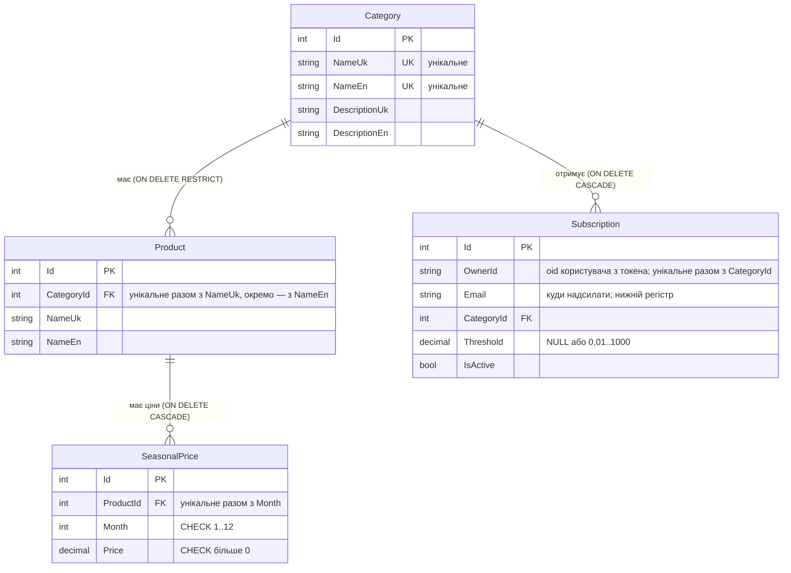

# Схема бази даних (PostgreSQL, EF Core)

## Від полів екранів до таблиць

Поля, які показують екрани: **Календар** — назва товару, місяць, ціна; **Категорії** — назва, опис, кількість підписок; **Підписки** — e-mail, категорія, поріг, «активна».

| Нормальна форма | Що зроблено |
|---|---|
| 1НФ | Кожне поле атомарне; ціни за 12 місяців — не 12 колонок і не список в одній комірці, а 12 рядків у `SeasonalPrices`. |
| 2НФ | Усі таблиці мають одноколонковий ключ `Id`, тому часткових залежностей від частини ключа немає. Природні ключі («товар + місяць», «користувач + категорія») закріплені унікальними індексами. |
| 3НФ | Транзитивних залежностей немає: категорія описується лише в `Categories`, товар — лише в `Products` (у цінах і підписках є тільки посилання `ProductId` / `CategoryId`). Кількість підписок і товарів **не зберігається** — вона обчислюється запитом `COUNT`, інакше її довелося б синхронізувати. Назви й описи двома мовами (`…Uk`, `…En`) — це різні атрибути однієї сутності, а не повтор. |

## ER-діаграма



## Унікальні індекси

| Таблиця | Індекс | Навіщо |
|---|---|---|
| `Categories` | `NameUk`, `NameEn` (окремо) | дві категорії не можуть мати однакову назву жодною мовою |
| `Products` | (`CategoryId`, `NameUk`), (`CategoryId`, `NameEn`) | назва товару не повторюється в межах категорії; індекс обслуговує й зовнішній ключ |
| `SeasonalPrices` | (`ProductId`, `Month`) | один товар має одну ціну на місяць |
| `Subscriptions` | (`OwnerId`, `CategoryId`) | один користувач підписується на категорію один раз; `OwnerId` — `oid` з токена Entra ID, не змінюється разом із поштою (e-mail зберігається в нижньому регістрі) |

Порушення унікальності (SQLSTATE `23505`) API повертає як **409** з `ProblemDetails`.

## Правила `OnDelete`

| Зовнішній ключ | Правило | Чому |
|---|---|---|
| `Products.CategoryId` → `Categories` | **Restrict** | категорію з товарами видалити не можна — товари не мають зникати разом з нею; API повертає 409 |
| `SeasonalPrices.ProductId` → `Products` | **Cascade** | ціни не існують без товару |
| `Subscriptions.CategoryId` → `Categories` | **Cascade** | підписка на видалену категорію втрачає сенс |

## Команди

```bash
docker compose up -d
dotnet user-secrets set "ConnectionStrings:Catalogue" "Host=localhost;Port=5433;Database=catalogue;Username=postgres;Password=postgres" --project ApiApp
dotnet tool install --global dotnet-ef            # або: dotnet tool update --global dotnet-ef
dotnet ef migrations add InitialCreate --project ApiApp
dotnet ef database update --project ApiApp
```

Схема змінюється лише міграціями (`dotnet ef database update`); застосунок сам таблиць не створює.
